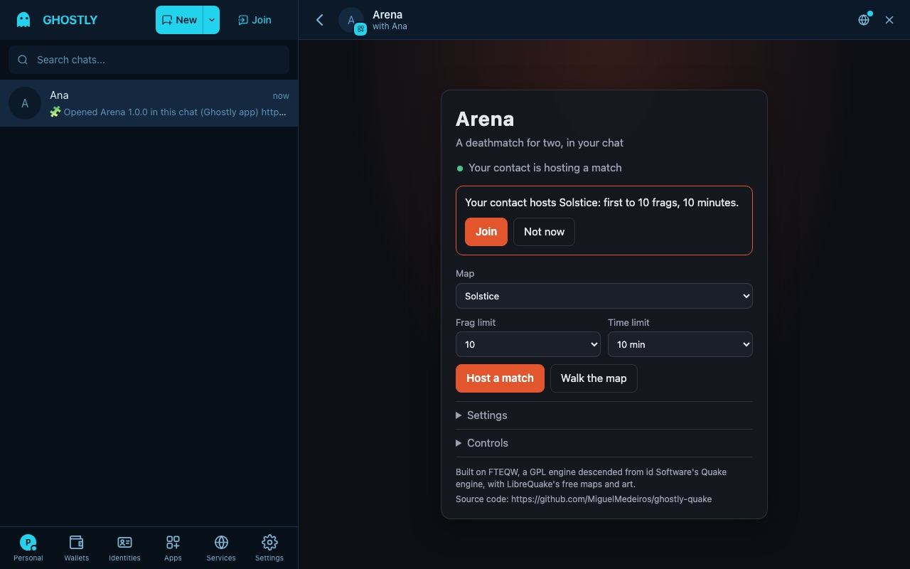
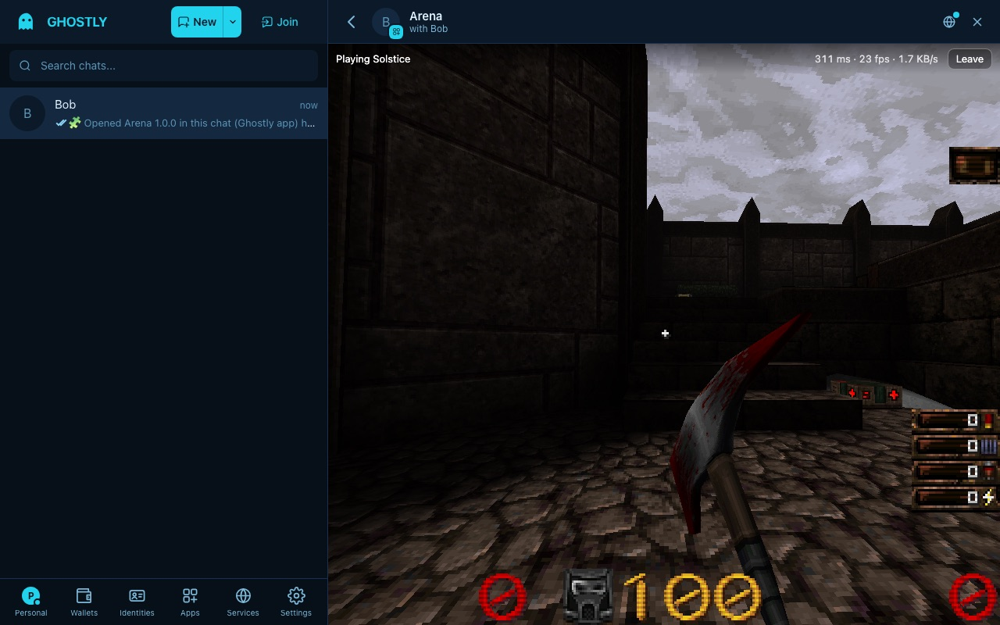

# Arena

A deathmatch for two, live in a [Ghostly](https://github.com/MiguelMedeiros/ghostly) chat. Open Arena in a 1:1 chat,
host a match on one of ten maps, and your contact joins from the invitation. One side's game runs the server and its
own player; the other side's game connects to it over the chat's live connection.

Arena is a Ghostly mini-app ([WISP 1200](https://github.com/MiguelMedeiros/ghostly/blob/dev/docs/wisps/1200-marketplace.md))
built on [FTEQW](https://github.com/fte-team/fteqw), a GPL engine descended from id Software's Quake engine, compiled to
WebAssembly, with the free maps, models and sounds of [LibreQuake](https://github.com/lavenderdotpet/LibreQuake). It
runs in the client's sandbox with no network: everything reaches it through `window.ghostly`, the broker. The engine's
packets travel in `apps/1` frames to the same app on the contact's side.




## Build

Node 22 or later.

```sh
npm ci
npm run typecheck
npm test              # the frames, the link, the session, the commands, the data and the built page
npm run build         # dist/index.html, dist/game/engine.wasm.gz, dist/game/arena.pk3
npm run digest        # each file's SHA-256 and the total against the 16 MiB a bundle may hold
npm run dev           # a dev server; outside Ghostly it plays alone (Walk the map) on a stand-in broker
npm run test:browser  # two sides in sandboxed frames under the runner's CSP play a match (npx playwright install chromium webkit once)
```

The build is reproducible: the same commit gives the same bytes. Two inputs are committed as built, so `npm run build`
needs neither Docker nor the network:

| Input | Made by | Checked by |
|---|---|---|
| `engine/dist/fte.js`, `engine/dist/fte.wasm.gz` | `npm run engine`: FTEQW at a pinned commit, `engine/patches/` applied, compiled in a pinned `emscripten/emsdk` image (needs Docker; run it under `lockf -k /tmp/ghostly-heavy.lock` on the shared Mac) | `npm run engine -- --check` (CI's engine job), `engine/dist/SHA256SUMS` |
| `data/arena.pk3` | `npm run gen:data`: LibreQuake v0.09-beta's release archives (pinned by SHA-256), cut to what `data/files.txt` and the maps need, sounds above 22,050 Hz resampled | `npm run gen:data -- --check` (CI) |

### What the bundle holds

| File | Size | What it is |
|---|---|---|
| `index.html` | 0.2 MB | The app and the engine's JavaScript glue, inline |
| `game/engine.wasm.gz` | 2.1 MB | FTEQW (client and server) in WebAssembly, gzipped; inflated in the page (fflate) |
| `game/arena.pk3` | 12.5 MB | The game data: 10 deathmatch maps, models, sounds, pictures and game code |
| `icon.png` | 40 KB | The icon (Arena's own art) |

14.1 MiB in all, of the 16 MiB a bundle may hold. The page reads the two game files with `ghostly.file` when it opens.

### The sandbox, and what the engine needed

- **No eval, no fetch, no workers.** The glue is built with `-sDYNAMIC_EXECUTION=0 -sENVIRONMENT=web`, gets the wasm as
  `Module.wasmBinary` and the files as ArrayBuffers, and is wrapped in `window.ghostlyFte(Module)` in a script of its own.
- **The network is the chat.** `engine/patches/0001-ghostly-chat-transport.patch` lets FTEQW's web build listen on
  `ws://ghostly.invalid/host` and makes that address a pipe to the page (`Module.ghostlyNet`); every other address
  fails. The host runs `sv_port_rtc ws://ghostly.invalid/host; map …`, the joiner `connect ws://ghostly.invalid/host`.
  `src/link.ts` batches the packets of each engine frame into one chat frame, at most 34 frames a second (the chat
  takes 48 frames, and 50 broker requests, a second), and drops the oldest when the queue grows (the netchan resends).
- **No pointer lock.** The runner's sandbox refuses it, so the patched glue reads each mousemove's `movementX` while the
  game wants the mouse, and the page keeps turning while the pointer rests at the left or right edge (`src/input.ts`).
  The arrow keys turn too.

### Checked by hand

Before a release, with the client versions, in the release's pull request or issue:

- **Desktop (macOS WKWebView):** a match between Desktop and the web app: the invitation, Join, both players see each
  other, mouse look and the edge turning, sounds after a click inside the window.
- **Safari (web app):** the same, and that the frame keeps 60 fps on a laptop.
- **Leaving:** Leave on either side, closing the app on either side, and the chat going offline: the joiner's match ends
  with the notice, the host's server waits, and a new Join works.

| Path | What it is |
|---|---|
| `src/main.ts` | The page: the broker, the session, the engine and the link wired together |
| `src/session.ts` | Who hosts, who joins, when a match ends |
| `src/protocol.ts` | The frames Arena sends, and the checks on what a peer sends (untrusted) |
| `src/link.ts` | The engine's packets over the chat: batching, rate, parts, pings |
| `src/engine.ts` | Boots FTEQW with the app's files and scripts; console commands |
| `src/config.ts` | quake.rc, ghostly.cfg, the host, join and leave commands, the settings |
| `src/input.ts` | Mouse look without a pointer lock: the edge turning |
| `src/ui.ts`, `src/style.css` | The lobby and the in-game bar |
| `src/strings.ts`, `src/languages.ts` | Every string, in Ghostly's 8 languages |
| `src/vendor/miniApp.ts` | The broker's types and limits, copied from Ghostly (see its header) |
| `engine/` | The engine: `patches/`, and `dist/` (the built glue and wasm, with their SHA-256) |
| `data/` | `files.txt` (what the pk3 holds) and `arena.pk3` |
| `assets/` | The icon, and the notices the page carries (FTEQW's GPL, LibreQuake's licence) |
| `scripts/` | `engine`, `data`, `assets` (copies the game files into dist), `digest`, `stage`, `bundle` (check:bundle) |
| `test/`, `test/browser/` | Vitest, and the Playwright specs with their two-sided harness and test broker |
| `docs/protocol.md`, `docs/PUBLISHING.md` | The frames, for another client or a bot; how a version is published |

## Versions

Both sides must run the same engine and data, or the engine refuses the connection. A version that changes either
raises at least the minor version; versions that differ only in their patch play together (`src/version.ts`), and the
lobby says when the contact's version cannot play with this one.

## Publish a new version

Only the holder of Arena's publisher key can sign an update. [docs/PUBLISHING.md](docs/PUBLISHING.md) has every step.
`app.ghostlyapp` at the root is the only bundle ever committed here. Never commit the key or a staged folder.

## License

Arena's own code: GPL-2.0-or-later, distributed as part of the whole under **GPL-2.0-only** (see [LICENSE](LICENSE)),
since FTEQW is GPL-2.0. The game data is LibreQuake's: art and maps BSD-3-Clause ([assets/librequake/COPYING](assets/librequake/COPYING)),
game code GPL-2.0-or-later; its contributors are in [assets/librequake/CREDITS](assets/librequake/CREDITS). The page
carries these notices and fflate's (MIT). The complete corresponding source of the bundle is this repository: the
engine's commit, the patches and the build recipe are in `scripts/engine.mjs` and `engine/`.

"Quake" is a trademark of id Software (ZeniMax Media); Arena is not affiliated with or endorsed by them. The name
appears here only to say where the engine comes from.
